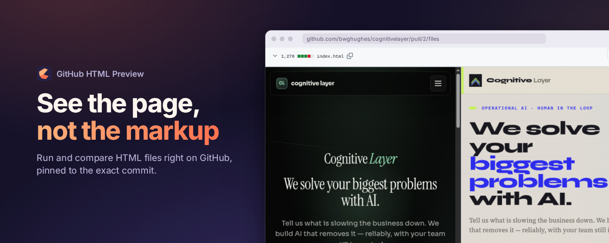
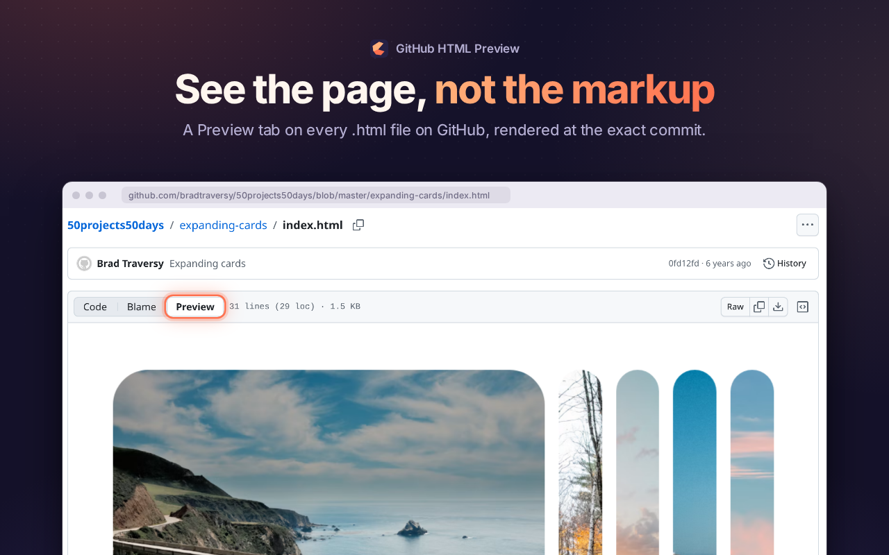
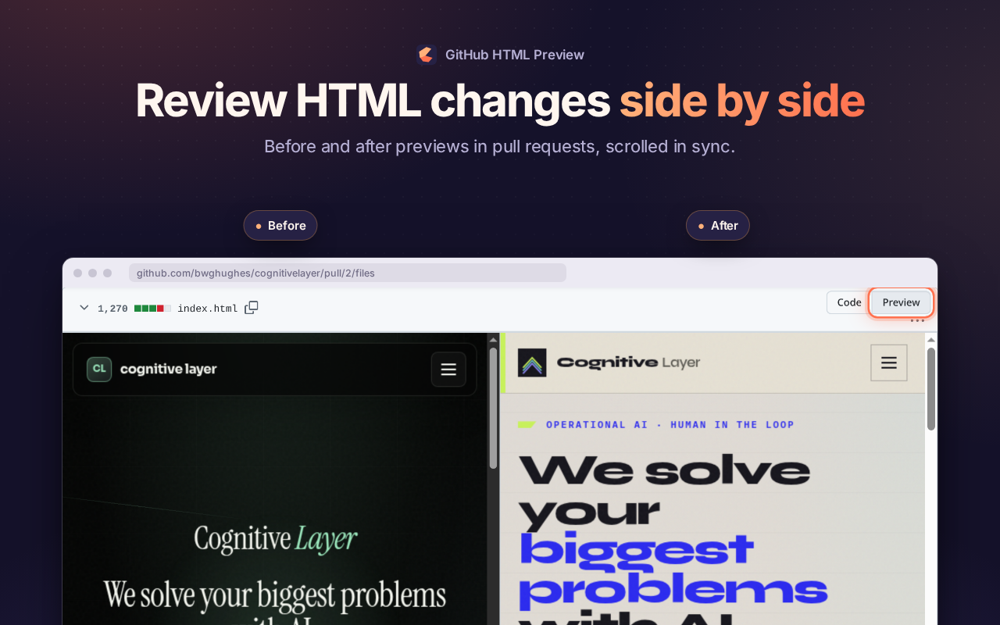
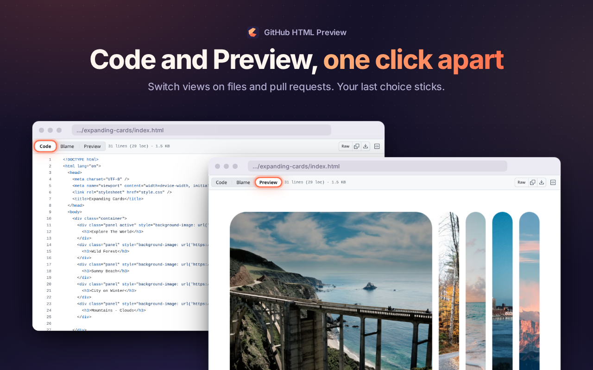
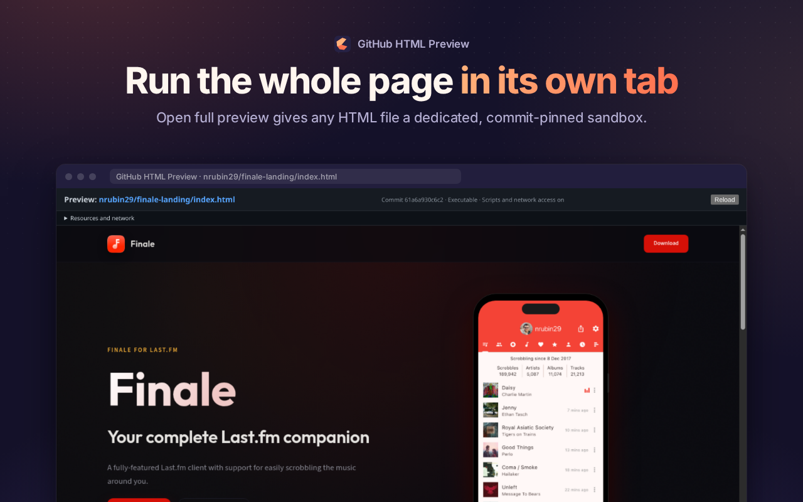

<p align="center">
  
</p>

<h1 align="center">GitHub HTML Preview</h1>

<p align="center">
  Run any <code>.html</code> file right on GitHub, and review HTML pull requests side by side, before and after.
</p>

<p align="center">
  <a href="https://chromewebstore.google.com/detail/github-html-preview/bhgobcihfebfgcgmdagfgpenamjfpfga"></a>
  &nbsp;
  <a href="https://github.com/tnfssc/github-html-preview/blob/develop/examples/demo/index.html"></a>
  &nbsp;
  <a href="https://github.com/tnfssc/github-html-preview/pull/28/files"></a>
</p>

---

Reports, prototypes, docs, email templates, coverage output: plenty of HTML lives on GitHub, and GitHub only shows you its source. GitHub HTML Preview adds a **Preview** tab that runs the real page, with its own CSS and JavaScript, at the exact commit you're looking at. You don't need to clone, run `python -m http.server`, or download a zip first.

<p align="center">
  
</p>

## Review HTML changes the way they look

Pull requests, commits and comparisons get **Code** and **Preview** controls. Edited files render before and after side by side, and scrolling stays in sync by matching headings and anchors. Added and deleted files render the side that exists. Forks work too: each side loads from its own repo and commit.

<p align="center">
  
</p>

## Everything you get

- **One click from Code to Preview.** Your last choice sticks across files and pull requests.
- **Pinned to the exact commit.** The page, its stylesheets, scripts and images all come from the commit on screen, never the latest branch tip.
- **Full-tab preview.** **Open full preview** runs the page in its own tab.
- **Comments pinned to the page.** Select text in a PR preview and choose **Comment** to anchor a normal PR comment to that element. Teammates with the extension see numbered pins; everyone else sees a plain comment.
- **Private repos, no tokens.** Private and SSO-protected repos use the GitHub session you're already signed into. The extension never asks for or stores a personal access token.
- **Fits into GitHub.** It follows GitHub's single-page navigation, collapsed files, lazy-loaded diffs and inline review comments, and adds no extra panels.

<table>
  <tr>
    <td></td>
    <td></td>
  </tr>
</table>

## Is it safe?

Previews are **executable**: the file's scripts really run. They run in a sandboxed frame with an opaque origin, so preview code **cannot** read your GitHub cookies or session, touch the GitHub page around it, use extension APIs, or fetch other repos as you.

It **can** reach the network, like any web page you visit. So a hostile page could send its own contents somewhere, draw a fake login box, or burn CPU. Preview code you trust, the same way you'd treat a link you click. Details are in the [security model](.docs/security-model.md).

## Try it in 10 seconds

1. [Add it to Chrome](https://chromewebstore.google.com/detail/github-html-preview/bhgobcihfebfgcgmdagfgpenamjfpfga).
2. Open the [animated demo](https://github.com/tnfssc/github-html-preview/blob/develop/examples/demo/index.html). The page you see is [`examples/demo/`](examples/demo), three plain files rendered live.
3. Open the [example pull request](https://github.com/tnfssc/github-html-preview/pull/28/files) and compare before and after.

## Development

Use Node.js 22.12+ and pnpm 11.28.3 (pinned in `package.json`).

```bash
pnpm install
pnpm run compile
pnpm test
pnpm run test:e2e
pnpm run test:smoke
pnpm run build
pnpm run build:debug
pnpm run zip
pnpm run zip:debug
```

- `pnpm test`: resolver, GitHub API, resource-limit, and packaged-manifest contracts.
- `pnpm run test:e2e`: deterministic Chromium extension workflows with mocked GitHub pages and assets.
- `pnpm run test:smoke`: live checks against current GitHub blob and pull-request DOM.

Load `.output/chrome-mv3/` through `chrome://extensions` with Developer mode enabled.

Debug builds output to `.output/chrome-mv3-debug/`. Reproduce problems with GitHub-page and extension-page DevTools open, then filter console output by:

```text
[gh-html-preview:debug]
```

Diagnostic logs include lifecycle events, repository paths, HTTP status, resource counts, timings, and failures. They exclude tokens and file contents.

Store screenshots live in [`store/`](store): `node store/capture.mjs` captures raw shots from a build, and `node store/render.mjs` composes them.

## Learn more

- [Product behavior and requirements](.docs/behavior.md): exact behavior, organization SSO, scroll sync, and the execution boundary.
- [Product specification](PRODUCT.md)
- [Security model](.docs/security-model.md)
- [Research notes](.docs/README.md)
